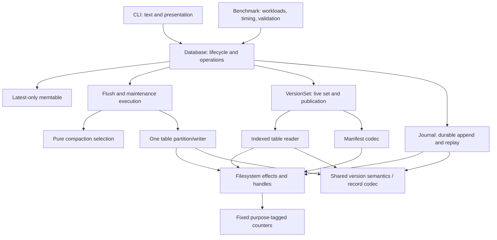

# Architecture

The database coordinates public operations. Separate modules own records, durable
storage, table access, compaction selection and metrics. The CLI and benchmark
client depend on the engine; the engine does not depend on either client.

## Ownership map

| Owner | Owns | Must not own |
| --- | --- | --- |
| `config` | Strict external admission and configuration-derived filter dimensions | Storage or policy execution |
| `record`, `framing` | Mutation semantics and protected byte envelopes | File handles, configuration parsing |
| `memtable`, `merge` | Latest memory state and sequence resolution | Serialization policy, persistence |
| `Database` | Public validation, process/thread ownership, failure state | A private compaction implementation |
| `VersionSet` | Live-set publication, layout indexes, orphan cleanup, bounded point readers and one validation cache | Workload generation |
| `maintenance` | One executor for checkpoint/compaction transitions | Choosing policy-specific overlaps |
| `compaction` | Deterministic selection over immutable descriptors | Database mutation or file effects |
| `table` | Indexed block format, persisted filter, partitioning | Manifest publication |
| `storage` | Handles, locks, exact effects, journal/manifest boundaries | Public map semantics |
| `metrics` | Named cumulative counts and immutable windows | Timers, global enable toggles, logical state |
| `lsm_bench` | Deterministic workloads, reference checks, timing and artifacts | A second storage implementation |

`table.metadata.TableInfo` is the one table descriptor. Mutable levels are not
exposed. `storage.manifest.Manifest` is the one persistent live-set authority.
The protected frame has one owner shared by all file formats. The mutation codec
has one owner shared by journal and table blocks. The partition writer has one
owner shared by flush and compaction. Dependencies use direct concrete interfaces.

The [specification](specification.md) defines behavior, the
[format](format.md) defines exact bytes, and typed source signatures define
implementation interfaces.

## Extending a rule

**A new compaction policy:** define its admitted tagged configuration, implement
its pure selector returning a `CompactionPlan`, and add selection/model cases.
Use the existing executor, table writer and manifest publisher. If a new policy
requires different visibility semantics (FIFO retention, for example), it is a new
visibility contract and requires corresponding specification changes.

**A codec, filter or merge implementation:** preserve its input/output contract and
validate it against independent byte vectors and semantic tests. Changes to a hash
or binary layout require a new format version. Performance comparisons use the
same benchmark client and durability settings.

The local architecture checks enforce package structure, dependency direction and
the absence of dynamic-import or unchecked-type bypasses.

## Benchmark ownership

`config` admits run/scenario/suite inputs. `workload` owns deterministic traces and
identity. `preparation` loads through the public API; `validation` owns the independent
map oracle. `measurement` owns the two timing modes and shared dispatcher. `runner`
coordinates phases. `suite` schedules and retains repetitions; `aggregation` and
`statistics` own descriptive summaries. `source` and `environment` capture provenance.
`artifacts` owns exclusive writes, `reporting` renders strict artifacts, and `profiling`
profiles only the measured phase through the same runner. None of these modules is
a dependency of the storage engine.

## Table-read ownership

`table.reader` owns physical access and its file lifetime. `table.block` admits a
complete block using the canonical record codec, and owns immutable records plus
binary-search keys. `table.cache` owns one byte-bounded LRU of exact-image admission
results, not file handles or persistence. `VersionSet` scopes the cache, passes it
to all readers, invalidates reclaimed tables and clears it on close. Scan/compaction
readers retain their own handles even when more than 32 tables participate. Cache
hits require fresh current bytes; the cache cannot authorize a partial validation.
